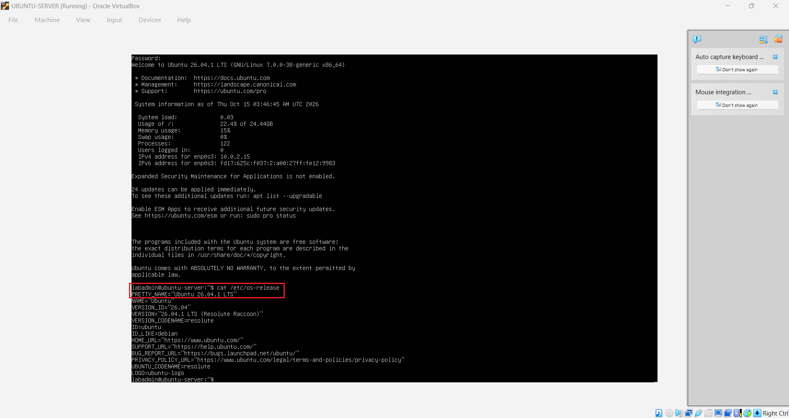
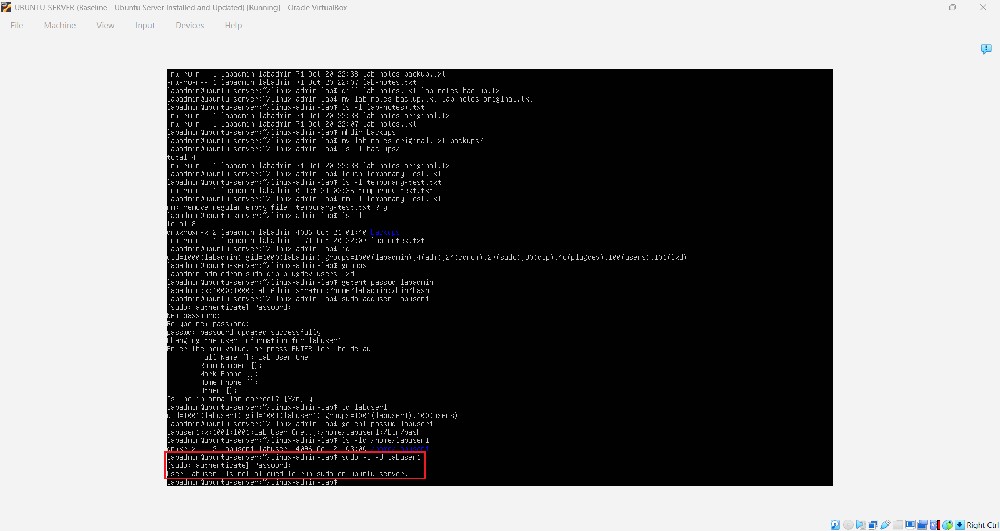
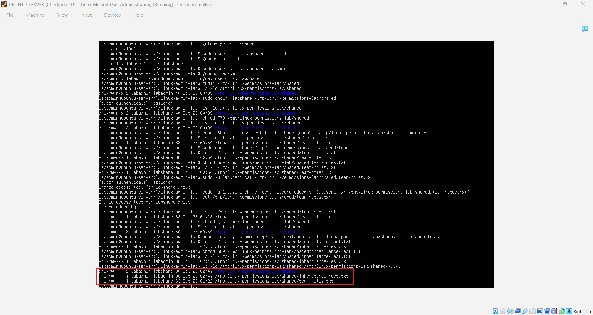
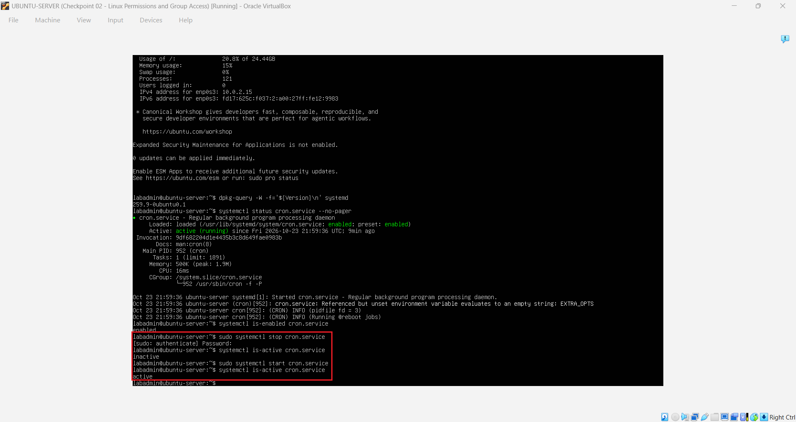
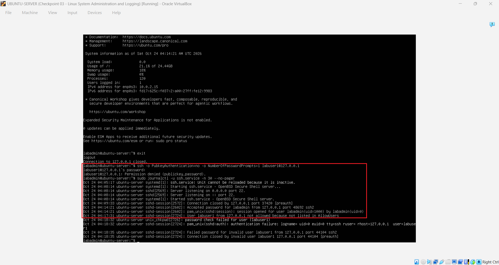
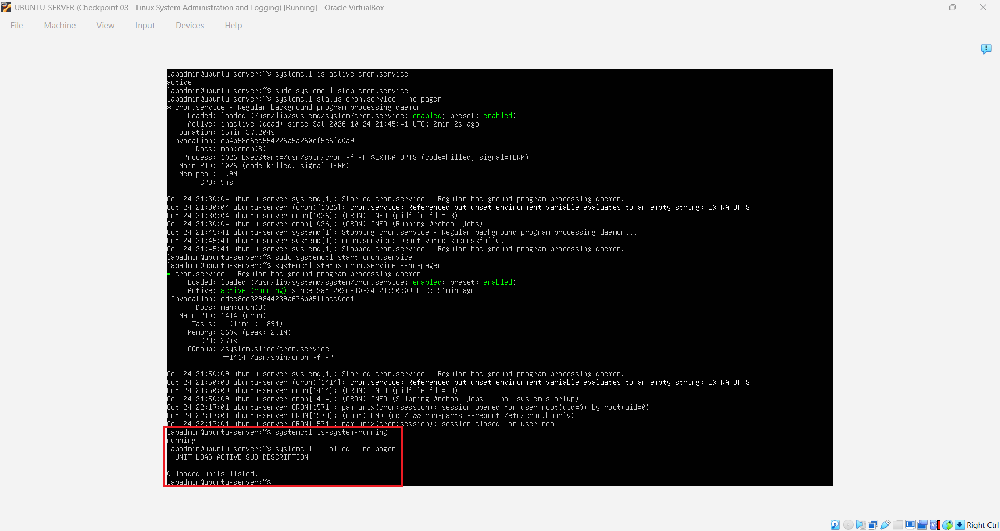

# Ubuntu Server Linux Administration & Security Lab

A hands-on Ubuntu Server home lab built using Oracle VirtualBox to practice Linux administration, command-line operations, user and group management, file permissions, system services, logging, SSH security, firewall configuration, and troubleshooting.

## Project Overview

This project involved installing, configuring, administering, securing, and troubleshooting Ubuntu Server 26.04.1 LTS in a controlled virtual environment.

The goal was to develop practical Linux administration and introductory cybersecurity skills while learning how to verify configuration changes, investigate system behavior, and recover from service interruptions.

I completed seven technical phases and documented the project through a detailed Build Guide, Project Understanding Notes, and original screenshots.

## Lab Environment

| Component | Configuration |
|---|---|
| Host operating system | Windows 11 |
| Virtualization platform | Oracle VirtualBox |
| Guest operating system | Ubuntu Server 26.04.1 LTS |
| Virtual machine | UBUNTU-SERVER |
| Virtual processors | 2 CPUs |
| Memory | 2 GB RAM |
| Virtual storage | 25 GB |
| Network configuration | NAT |
| Administrator account | `labadmin` |
| Standard user account | `labuser1` |
| External storage | Samsung T5 SSD |
| Security tools | UFW, OpenSSH Server |
| Recovery | Original baseline and Checkpoints 01–04 |

The virtual machine and supporting lab files were maintained on an external SSD. VirtualBox snapshots preserved important stages of the project for recovery and future reference.

## Project Objectives

- Install and verify an Ubuntu Server virtual machine.
- Develop confidence using Linux command-line tools.
- Manage files, directories, users, groups, and permissions.
- Understand administrative privileges and least privilege.
- Practice package management, process monitoring, and service administration.
- Investigate system activity through logs.
- Configure foundational network and SSH access controls.
- Troubleshoot a simulated service interruption.
- Verify system health and preserve the completed environment.

## Technical Implementation

### Phase 1 — Virtual Machine Preparation and Ubuntu Server Installation

- Created and configured an Ubuntu Server virtual machine in Oracle VirtualBox.
- Verified the Ubuntu Server installation ISO using SHA-256.
- Configured virtual CPU, memory, disk storage, and NAT networking.
- Installed Ubuntu Server and established the `labadmin` account.
- Verified basic networking and DNS resolution.
- Applied software updates and confirmed successful system operation.
- Preserved the initial configured environment as a VirtualBox baseline.

### Phase 2 — Linux File Management and User Administration

- Practiced command-line navigation and Linux filesystem operations.
- Created and organized directories and practice files.
- Used commands including `pwd`, `ls`, `cd`, `mkdir`, `touch`, `cat`, `cp`, `mv`, and `rm`.
- Practiced output redirection, file copying, renaming, and verification.
- Created the standard Linux account `labuser1`.
- Inspected user identities, group memberships, and administrative privileges.
- Confirmed that the standard account was not authorized to perform administrative operations using `sudo`.

### Phase 3 — Linux Permissions and Group Access

- Inspected Linux file ownership and permission settings.
- Practiced controlling file access using `chmod` and `chown`.
- Tested permission modes including `600`, `660`, and `770`.
- Verified file-access restrictions between administrator and standard user accounts.
- Created the `labshare` group to support controlled collaboration.
- Configured a shared directory for authorized group members.
- Tested group-based file access using `labuser1`.
- Enabled the setgid directory permission and verified group ownership inheritance.

### Phase 4 — Linux System Administration and Logging

- Practiced Ubuntu package management using APT.
- Applied available package upgrades and verified system operation.
- Inspected running Linux processes using `ps` and `top`.
- Practiced managing a temporary background process.
- Inspected and controlled systemd services using `systemctl`.
- Started, stopped, and verified the state of `cron.service`.
- Reviewed system and service events using `journalctl`.
- Learned to distinguish running processes from system-managed services.

### Phase 5 — Linux Security Administration

- Installed and inspected OpenSSH Server.
- Investigated SSH socket activation and service behavior.
- Configured UFW with a default-deny incoming policy and default-allow outgoing policy.
- Allowed OpenSSH connections on TCP port `22`.
- Reviewed effective SSH authentication settings.
- Created a dedicated SSH configuration file containing `AllowUsers labadmin`.
- Validated SSH configuration syntax and effective access restrictions.
- Successfully tested authorized SSH access using `labadmin`.
- Verified that unauthorized SSH authentication using `labuser1` was rejected.
- Reviewed authentication logs to confirm enforcement of the access restriction.
- Verified that the firewall and SSH configuration persisted after reboot.

### Phase 6 — Service Troubleshooting and Recovery

- Performed a controlled service-interruption exercise using `cron.service`.
- Confirmed the service's initial running state.
- Stopped the service to simulate an interruption.
- Inspected the inactive service state and available recorded events.
- Restored the service using `systemctl`.
- Verified that the service returned to an active running state.
- Practiced an evidence-based troubleshooting workflow: identify, investigate, correct, and verify.

### Phase 7 — Final Verification and Environment Preservation

- Confirmed that systemd reported the Ubuntu Server system as `running`.
- Checked for failed systemd units.
- Verified that the final result reported `0 loaded units listed`.
- Shut down the Ubuntu Server virtual machine cleanly.
- Preserved the completed environment using **Checkpoint 04 — Linux Security and Troubleshooting Verified**.
- Retained the original baseline and earlier checkpoints.
- Organized 16 original screenshots documenting the technical exercises.

## Selected Technical Evidence

Six annotated screenshots were prepared to highlight important technical outcomes for the public portfolio.

| Evidence | Demonstrated activity |
|---|---|
| [P02-04](Portfolio-Screenshots/P02-04-Ubuntu-First-Login-OS-Verification-Annotated.png) | Ubuntu installation and initial operating system verification |
| [P02-09](Portfolio-Screenshots/P02-09-Linux-User-Privilege-Verification-Annotated.png) | Standard user privilege restriction |
| [P02-12](Portfolio-Screenshots/P02-12-Linux-Group-Access-Control-Annotated.png) | Linux group-based access control |
| [P02-13](Portfolio-Screenshots/P02-13-Linux-Service-Management-Annotated.png) | Linux service management and recovery |
| [P02-15](Portfolio-Screenshots/P02-15-SSH-Access-Control-Verification-Annotated.png) | SSH access restriction and authentication verification |
| [P02-16](Portfolio-Screenshots/P02-16-Final-System-Health-Verification-Annotated.png) | Final system-health verification |

The six annotated screenshots are included in the Portfolio-Screenshots folder as supporting visual evidence. Each screenshot is linked above for direct review.

The complete set of 16 original screenshots remains preserved with the local project documentation.

## Technical Evidence Highlights

The following annotated screenshots demonstrate selected results from the Ubuntu Server lab. Each example highlights the technical activity performed, the verification evidence, and its relevance to Linux administration or security.

### 1. Ubuntu Server Installation and OS Verification

After installing Ubuntu Server in Oracle VirtualBox, I signed in using the administrator account and verified the operating system version with `cat /etc/os-release`.

The output confirmed that Ubuntu Server 26.04.1 LTS was installed successfully. This established a verified starting point for the remaining Linux administration and security exercises.

### 2. Linux User Privilege Verification

I created a standard Linux user account, `labuser1`, to practice account administration and verify the separation between standard and administrative privileges.

Using `id` and `groups`, I inspected the account's identity and group memberships. I then tested whether the standard account could perform administrative operations using `sudo`.

The result confirmed that `labuser1` was not authorized to use `sudo`. This demonstrated the principle of least privilege, where users receive only the permissions necessary for their responsibilities.

### 3. Linux Group Access Control

I created a Linux group named `labshare` to practice managing shared directory access between authorized users.

I configured a shared directory under `/tmp/linux-permissions-lab/shared`, assigned the appropriate group ownership, and adjusted directory permissions to allow controlled collaboration.

I tested access using the standard account `labuser1` and verified that authorized group members could access and modify shared files.

I also enabled the setgid permission on the shared directory and verified that newly created files inherited the directory's group ownership.

This exercise demonstrated how Linux file permissions, group membership, and setgid inheritance work together to support secure collaboration and consistent access control.

### 4. Linux Service Management

I practiced managing Linux system services using `systemctl`, focusing on the `cron.service` scheduling service.

I inspected the service's current status using `systemctl status cron.service` and verified whether it was active.

I then stopped the service using `sudo systemctl stop cron.service` and checked its status again to confirm that it had become inactive.

After verifying the stopped state, I restarted the service using `sudo systemctl start cron.service` and confirmed that it returned to an active state.

This exercise demonstrated how system administrators can control services, verify their operating states, and restore normal functionality after a service interruption.

### 5. SSH Access Control Verification

I configured OpenSSH Server on Ubuntu Server to practice securing remote administrative access.

I reviewed the effective SSH authentication settings and created a dedicated SSH configuration file containing `AllowUsers labadmin` to restrict SSH access to the authorized administrator account.

After validating the SSH configuration, I tested remote authentication using both the administrator account `labadmin` and the standard account `labuser1`.

The administrator account was able to authenticate successfully, while the standard account was denied access.

I then reviewed SSH authentication logs using `journalctl` to verify that the access restriction was being enforced.

This exercise demonstrated the importance of least privilege, secure remote access configuration, and log-based verification when managing Linux systems.

### 6. Final System Health Verification

After completing the Linux administration, security configuration, and troubleshooting exercises, I performed a final system-health verification on Ubuntu Server.

I used `systemctl is-system-running` to check the overall systemd state. The command returned `running`, indicating that the system was operating normally according to systemd.

I then used `systemctl --failed --no-pager` to identify any failed systemd units.

The output reported `0 loaded units listed`, confirming that no failed systemd units were detected at the time of verification.

After completing these checks, I shut down the virtual machine cleanly and preserved the finished lab environment using **Checkpoint 04 — Linux Security and Troubleshooting Verified**, while retaining the original baseline and previous checkpoints.

This final verification demonstrated the importance of checking system health after administrative changes, confirming recovery results, and preserving a stable environment for future troubleshooting or reference.

## Key Skills Demonstrated

**Linux administration**
- Ubuntu Server installation and maintenance
- Command-line navigation and file management
- Software package management
- Process and service monitoring

**Identity and access management**
- Linux user and group administration
- File ownership and permission configuration
- Administrative privilege restrictions
- Shared directory access and setgid inheritance

**Cybersecurity fundamentals**
- Least privilege
- Linux firewall configuration
- SSH authentication and access restrictions
- Layered access controls
- Authentication log analysis

**Troubleshooting and documentation**
- Service-status investigation
- System log review
- Controlled service restoration
- Verification of administrative changes
- Recovery checkpoint management
- Technical documentation and evidence collection

## Challenges and Lessons Learned

One important lesson involved understanding the difference between SSH service status and SSH socket activation. An inactive `ssh.service` did not necessarily indicate unavailable SSH connectivity because the socket could remain active and initiate the service when required.

Another lesson involved Linux permissions and group-based collaboration. I learned that group ownership, directory permissions, and setgid inheritance serve different purposes and must be verified independently.

The controlled service troubleshooting exercise reinforced the importance of checking system conditions before and after corrective actions.

Throughout the project, I developed a consistent practice of verifying results rather than assuming that a command had produced the intended outcome.

## Project Documentation

The complete project documentation includes:

- **Build Guide:** Eight sections covering the lab environment, implementation, verification, screenshots, and project conclusion.
- **Project Understanding Notes:** Six educational sections explaining the Linux concepts, commands, security controls, troubleshooting methods, and lessons learned.
- **Technical Screenshots:** Six selected annotated portfolio screenshots and 16 original screenshots preserved locally.
- **VirtualBox Recovery Points:** Original baseline and four checkpoints retained with the project environment.

The complete Build Guide and Project Understanding Notes are maintained in Google Drive as the primary documentation archive.

## Project Outcome

All seven technical phases were successfully completed.

The final verification confirmed that systemd reported the server as running, with zero failed units listed at the time of inspection.

The finished environment was preserved through VirtualBox recovery checkpoints, and the supporting documentation and screenshot evidence were organized for future reference.

This project strengthened my practical understanding of Linux administration, access control, security configuration, logging, and troubleshooting.

It also builds on my previous Windows 11 Help Desk Home Lab and supports my continued development toward entry-level IT, cybersecurity, and longer-term governance, risk, and compliance responsibilities.

**Technical implementation status:** Complete

**Portfolio documentation:** Final GitHub review and evidence organization in progress

